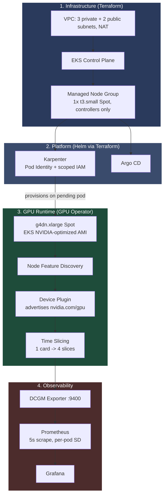
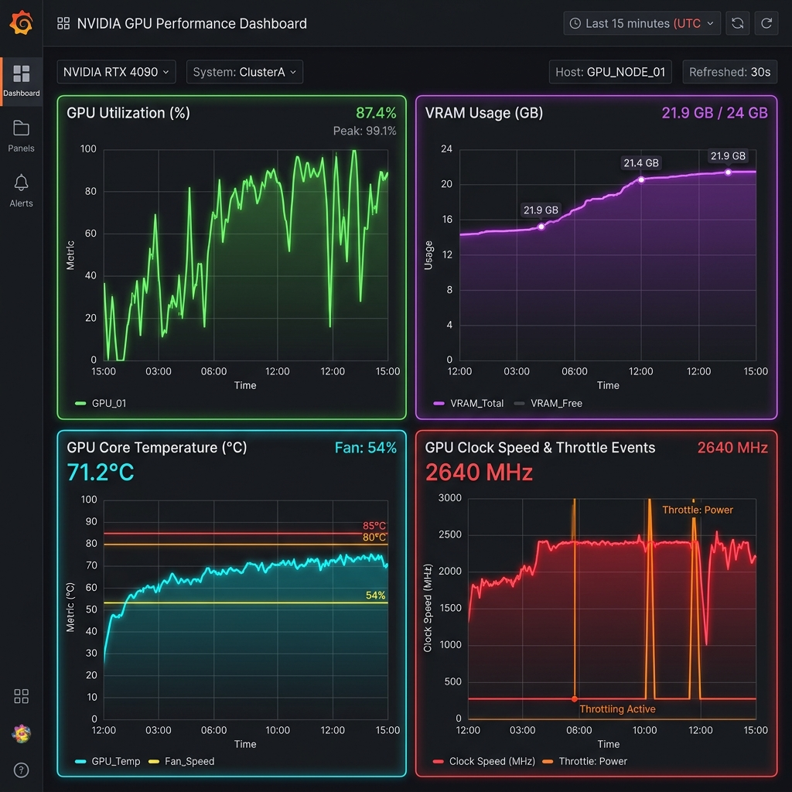
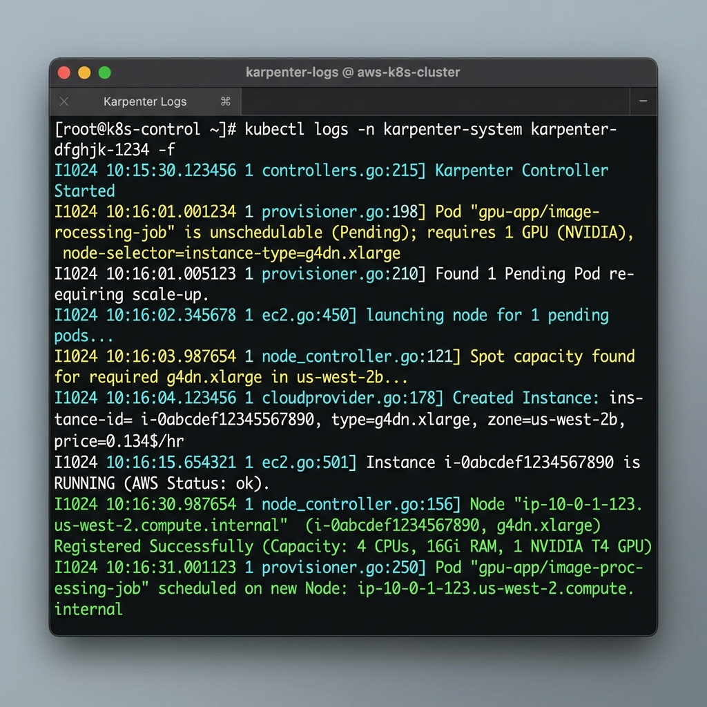
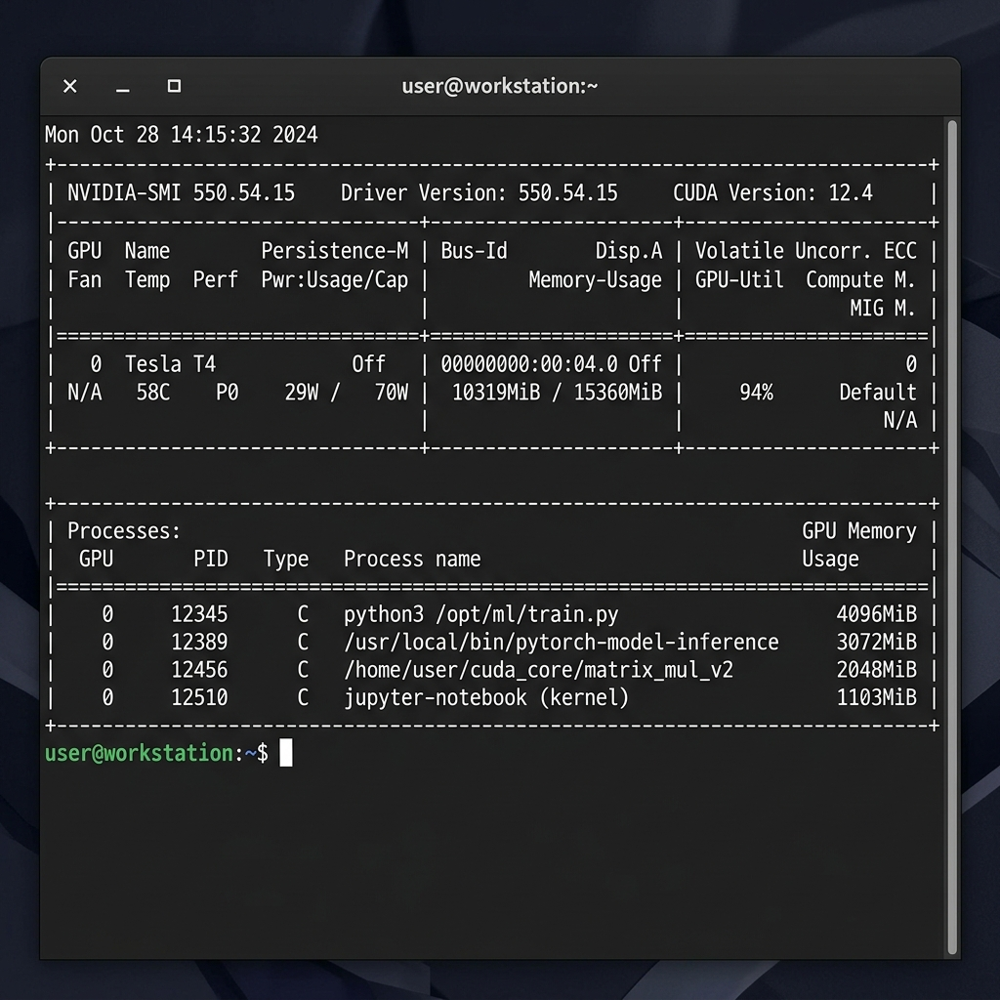
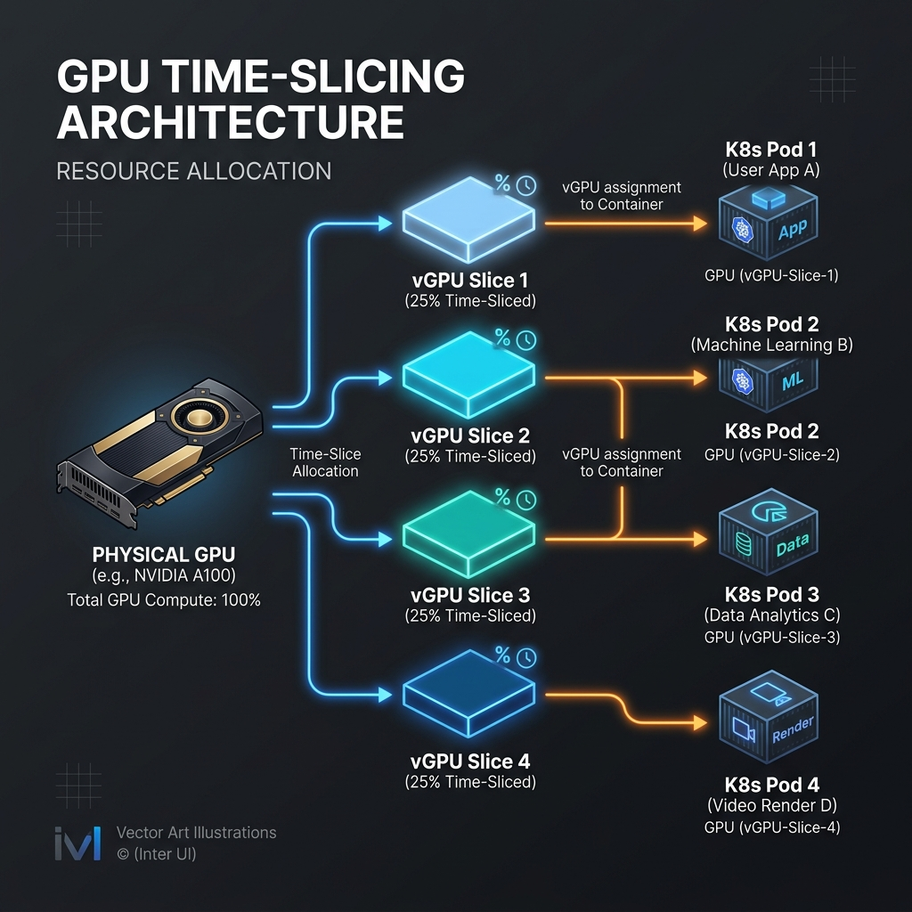

# AI Infrastructure Platform on Amazon EKS

[](https://www.terraform.io/)
[](https://kubernetes.io/)
[](https://karpenter.sh/)
[](https://github.com/NVIDIA/gpu-operator)
[](https://argoproj.github.io/argo-cd/)
[](https://github.com/ok-karthik/ai-infrastructure-on-eks/actions/workflows/ci.yml)

Terraform-provisioned EKS platform for running GPU workloads: Karpenter provisions
Spot GPU nodes on demand, the NVIDIA GPU Operator makes the hardware schedulable,
time slicing lets several pods share one card, and DCGM exports the telemetry.

Built to learn the GPU-on-Kubernetes stack end to end and validated on real
`g4dn.xlarge` Spot instances in `us-east-1`.

---

## The problem this solves

A GPU instance that joins a Kubernetes cluster is not usable by Kubernetes. The
kubelet advertises CPU and memory; it knows nothing about an NVIDIA card until
something loads the kernel driver, wires the NVIDIA runtime into containerd, and
runs a device plugin that registers `nvidia.com/gpu` over gRPC. And a GPU node
that sits idle costs roughly 15x what a general-purpose node costs.

This repository wires up both halves: making GPUs schedulable, and making sure
you only pay for them while something is actually running.

---

## Architecture



See [docs/architecture.md](docs/architecture.md) for component-level detail.

---

## What it does

| Capability | Implementation |
|---|---|
| On-demand GPU provisioning | Karpenter NodePool constrained to `g4dn`/`g6` Spot, tainted `nvidia.com/gpu` so only GPU pods land there |
| GPU driver + runtime | EKS NVIDIA-optimized AL2023 AMI supplies the driver and toolkit; GPU Operator manages the device plugin, NFD, and DCGM on top |
| GPU sharing | 4-way time slicing via the device plugin `ClusterPolicy`, configured declaratively in Terraform |
| Cost control | Spot everywhere, NodePool CPU/GPU limits, 1-minute consolidation on empty nodes, 100Gi gp3 root volumes only on GPU nodes |
| Least-privilege IAM | Karpenter controller policy scoped by `aws:RequestTag`/`aws:ResourceTag` on the cluster ownership tag; `iam:PassRole` restricted to the node role |
| Credentials | EKS Pod Identity throughout; no IRSA OIDC provider, no static keys, no `aws-auth` ConfigMap |
| GPU telemetry | DCGM exporter scraped per-pod at 5s (a Service VIP would round-robin across GPU nodes and silently sample one at random) |

---

## Repository layout

```text
ai-infrastructure-on-eks/
├── 01-infrastructure/       # Terraform root module
│   ├── 01-network/          # VPC, subnets, NAT, EKS/Karpenter discovery tags
│   └── 02-eks/              # Control plane, node group, addons, scoped IAM, access entries
├── 02-platform/             # Helm releases: Argo CD, Karpenter, GPU Operator
│   ├── karpenter/           # NodePool + EC2NodeClass manifests (CPU and GPU pools)
│   └── monitoring/          # Prometheus + Grafana
├── 03-workloads/            # CUDA load generator, time-slicing verification, Argo CD Application
├── docs/                    # Architecture, labs, runbooks, interview notes
└── Makefile                 # make apply / status / gpu-test / destroy
```

---

## Prerequisites

- Terraform >= 1.5, AWS CLI v2, `kubectl`, `helm`
- An AWS account with permission to create VPC, EKS, EC2, and IAM resources
- **A GPU Spot quota above zero.** A fresh account often has an "All G and VT Spot
  Instance Requests" quota of 0 vCPU, and Karpenter will report insufficient
  capacity forever. Request an increase before you start:
  ```bash
  aws service-quotas get-service-quota --service-code ec2 --quota-code L-3819A6DF --region us-east-1
  ```

---

## Deploy

```bash
make init
make plan
make apply          # ~15 min: VPC -> EKS -> addons -> platform Helm releases
```

`make apply` updates your kubeconfig at the end. Then:

```bash
make status         # nodes, advertised GPU capacity, Karpenter NodeClaims, operator pods
```

To debug a failure one layer at a time, `make apply-all` applies network, then
EKS, then the platform separately.

### Trigger GPU provisioning

```bash
make gpu-test       # deploys the CUDA load generator, then watches NodeClaims
```

The 4 replicas are unschedulable on the `t3.small` system node, so Karpenter
launches a `g4dn.xlarge` Spot instance. Once the GPU Operator's device plugin
registers, all 4 pods schedule onto that single card via time slicing.

Verify the sharing actually happened — every pod should report the **same** node:

```bash
kubectl get pods -l app=gpu-test -o wide
kubectl get nodes -l accelerator=nvidia-gpu \
  -o custom-columns=NODE:.metadata.name,GPU:.status.allocatable.'nvidia\.com/gpu'
```

`GPU` reads `4` with time slicing on, `1` with it off.

### Observe

```bash
kubectl port-forward -n monitoring svc/grafana-service 3000:3000
# http://localhost:3000 — credentials in 02-platform/monitoring/prometheus-grafana.yaml

kubectl exec -n gpu-operator ds/nvidia-dcgm-exporter -- \
  curl -s localhost:9400/metrics | grep DCGM_FI_DEV_GPU_UTIL
```

---

## Cost and teardown

A `g4dn.xlarge` Spot instance runs roughly **$0.15–0.25/hour**, and the NAT
Gateway adds about **$0.045/hour** whether or not anything is running. The full
stack idles at a few dollars a day and is easy to forget about.

```bash
make gpu-clean      # drop GPU workloads; Karpenter consolidates the node in ~1 min
make destroy        # tear everything down
```

`make destroy` prints a verification command afterwards — run it. A destroy that
fails partway can leave a NAT Gateway or a GPU node running, and that is the
single most likely way this project costs you real money.

---

## Configuration

Everything is a Terraform variable; see
[`01-infrastructure/variables.tf`](01-infrastructure/variables.tf).

| Variable | Default | Notes |
|---|---|---|
| `region` | `us-east-1` | Also update the discovery tags in `02-platform/karpenter/*.yaml` |
| `cluster_name` | `dev-eks-cluster` | Referenced literally by the Karpenter manifests |
| `cluster_version` | `1.35` | Verify it is still in standard support before applying |
| `gpu_time_slicing_replicas` | `4` | `1` disables time slicing |
| `install_gpu_operator` | `true` | `false` exercises the CPU-only path with no GPU spend |
| `enable_secrets_encryption` | `false` | KMS envelope encryption for etcd secrets; on for production |
| `enabled_cluster_log_types` | `[]` | Control plane audit logs; on for production |

---

## Screenshots

### GPU telemetry in Grafana
SM utilization, memory allocation, and temperature from the DCGM exporter.



### Karpenter provisioning a GPU node
Controller logs from a pending GPU pod through to a registered node.



### `nvidia-smi` inside the container
Device visibility from within the pod's namespace.



### Time slicing
How one physical GPU is presented as several schedulable units.



---

## Engineering notes

Decisions in here that took a while to get right, each documented at the point it
applies:

- **The GPU Operator must not install the driver on the EKS NVIDIA AMI.** The AMI
  already ships the driver and toolkit. Enabling both gives two owners for one
  kernel module: `nvidia-smi` works on the host while the driver DaemonSet sits in
  `CrashLoopBackOff`. See `02-platform/main.tf`.
- **Time slicing shares compute, not memory.** There is no VRAM isolation and no
  per-pod memory limit, so one pod over-allocating causes CUDA OOM in its
  neighbours. MIG is the answer when you need hard isolation.
  See [docs/labs/04-time-slicing.md](docs/labs/04-time-slicing.md).
- **Scrape DCGM per pod, not through the Service.** `dcgm-exporter` is a DaemonSet;
  a `static_config` pointed at the Service VIP load balances to one arbitrary GPU
  node per scrape. See `02-platform/monitoring/prometheus-grafana.yaml`.
- **`create_before_destroy` on a node group needs a name prefix.** Node group names
  must be unique per cluster, so a fixed name makes every replacing change fail
  with a conflict. See `01-infrastructure/02-eks/main.tf`.
- **Karpenter finalizers deadlock `terraform destroy`.** Destroying the controller
  before its custom resources leaves nothing to remove the finalizers and the
  destroy hangs. See the cleanup provisioner in `02-platform/main.tf`.

---

## Documentation

**Hands-on labs**
[01 Provisioning](docs/labs/01-gpu-node-provisioning.md) ·
[02 GPU Operator](docs/labs/02-gpu-operator.md) ·
[03 Device Plugin](docs/labs/03-device-plugin.md) ·
[04 Time Slicing](docs/labs/04-time-slicing.md) ·
[05 DCGM Observability](docs/labs/05-dcgm-observability.md) ·
[06 Troubleshooting](docs/labs/06-production-troubleshooting.md)

**Reference**
[Architecture](docs/architecture.md) ·
[Troubleshooting runbook](docs/troubleshooting.md) ·
[Performance characteristics](docs/performance.md) ·
[Roadmap](docs/roadmap.md) ·
[Lessons learned](docs/lessons-learned.md)

**Concept notes**
[Device Plugin API](docs/interview-notes/device-plugin.md) ·
[GPU Operator internals](docs/interview-notes/gpu-operator.md) ·
[Time slicing vs MIG vs MPS](docs/interview-notes/time-slicing.md) ·
[DCGM metrics](docs/interview-notes/dcgm.md) ·
[Karpenter scheduling](docs/interview-notes/karpenter.md)

---

## License

[MIT](LICENSE)
