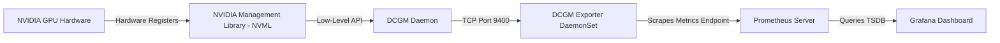

# Systems Design: GPU Observability & Telemetry

This document details GPU observability and telemetry systems using the DCGM Exporter and Prometheus on EKS.

---

## Observability Architecture

GPU observability requires scraping internal device registers and sensor matrices. The DCGM Exporter runs as a DaemonSet on all GPU-enabled nodes to expose these metrics.

---

## Important Production Metrics

DCGM exporter publishes metrics with the `DCGM_FI_` prefix. `DEV` fields come from
the driver directly; `PROF` fields come from the profiling subsystem and carry
more overhead but far more insight.

| Metric Name | Description | Diagnostic Value |
|---|---|---|
| `DCGM_FI_DEV_GPU_UTIL` | Percentage of time at least one kernel was resident on the GPU. | Cheapest utilization signal. Beware: measures occupancy over time, not throughput — one tiny kernel looping forever reads 100%. |
| `DCGM_FI_PROF_SM_ACTIVE` | Fraction of SMs with at least one active warp. | The honest utilization metric. Reveals a "100% utilized" GPU that is actually using a fraction of its SMs. |
| `DCGM_FI_PROF_PIPE_TENSOR_ACTIVE` | Fraction of cycles the tensor pipes are active. | Whether a training/inference job is actually hitting tensor cores or falling back to FP32. |
| `DCGM_FI_DEV_FB_USED` | Frame buffer (VRAM) in use, MiB. | Identifies leaks and headroom. Under time slicing this is the shared budget with no per-pod enforcement. |
| `DCGM_FI_DEV_FB_FREE` | Frame buffer free, MiB. | Whether another model will fit on this node. |
| `DCGM_FI_DEV_GPU_TEMP` | Core temperature, °C. | Correlates throughput drops with thermal limits. |
| `DCGM_FI_DEV_POWER_USAGE` | Board power draw, Watts. | Sustained draw at TDP is the leading indicator of an imminent clock throttle. |
| `DCGM_FI_DEV_SM_CLOCK` | Current SM clock, MHz. | A low clock alongside high utilization means throttling, not compute saturation. |
| `DCGM_FI_DEV_CLOCK_THROTTLE_REASONS` | Bitmask of active throttle causes. | Distinguishes thermal from power from reliability throttling. |
| `DCGM_FI_PROF_PCIE_TX_BYTES` / `_RX_BYTES` | PCIe bytes transferred. | Identifies host-to-device transfer as the bottleneck rather than compute. |
| `DCGM_FI_DEV_XID_ERRORS` | NVIDIA XID fault code. | The primary hardware-health alert. Non-zero means a real driver or hardware fault. |
| `DCGM_FI_DEV_ECC_DBE_VOL_TOTAL` | Uncorrectable ECC errors. | Failing memory. On Spot, replace the node rather than debugging it. |

---

## Technical Deep-Dives

### 1. DCGM Exporter Pod Mapping
The DCGM Exporter queries Kubelet's local pod resources API endpoint (`/var/lib/kubelet/pod-resources/kubelet.sock`) to map container IDs and GPU device UUIDs to pod metadata namespaces. This maps raw hardware counters to specific Kubernetes resources.

### 2. XID Error Codes
An XID error is a critical system event logged by the NVIDIA driver. A non-zero value represents a driver or hardware fault:
*   **XID 31:** Memory page fault (workload attempting to read out of bounds).
*   **XID 43:** GPU driver crash (often requiring a node reboot).
*   **XID 45:** PCIe bus error (hardware disconnection, node transitions to `NotReady`).

### 3. Throttling Mechanics
*   **Power Throttling:** TDP limits are saturated, restricting clocks.
*   **Thermal Throttling:** Core temperature reaches high safety limits (e.g., 85°C), forcing clock drops.

---

## Operational Notes
*   **Scale on the right signal.** CPU metrics say nothing about GPU saturation. Drive autoscaling from `DCGM_FI_PROF_SM_ACTIVE` (real compute occupancy) or `DCGM_FI_DEV_FB_USED` (memory pressure), not from `DCGM_FI_DEV_GPU_UTIL` alone.
*   **High-resolution scrapes.** GPU work arrives in bursts; a 30s interval samples the gaps and reports an idle GPU. This platform scrapes at 5s.
*   **Scrape per pod, not through the Service.** `dcgm-exporter` is a DaemonSet. A `static_config` aimed at the Service VIP load balances to one arbitrary GPU node per scrape, silently producing meaningless graphs across a multi-node fleet. Use `kubernetes_sd_configs` with `role: pod` — see `02-platform/monitoring/prometheus-grafana.yaml`.
*   **Alerting triggers.** Alert on `DCGM_FI_DEV_XID_ERRORS > 0` and on any non-zero `DCGM_FI_DEV_ECC_DBE_VOL_TOTAL` to catch failing hardware before workloads do.
*   **Socket Path Access:** The DCGM Exporter requires host path mounts to read Kubelet socket endpoints for metadata injection.

---

## Related Documentation
*   **Core Systems:** [Architecture Topology](../architecture.md) | [Troubleshooting Runbook](../troubleshooting.md) | [Performance Profiling](../performance.md)
*   **Sub-Component Architecture:** [Device Plugin Interface](device-plugin.md) | [GPU Operator Internals](gpu-operator.md) | [Virtualization Models](time-slicing.md) | [Karpenter Scheduling](karpenter.md)
*   **Detailed Labs:** [05: Observability](../labs/05-dcgm-observability.md)
