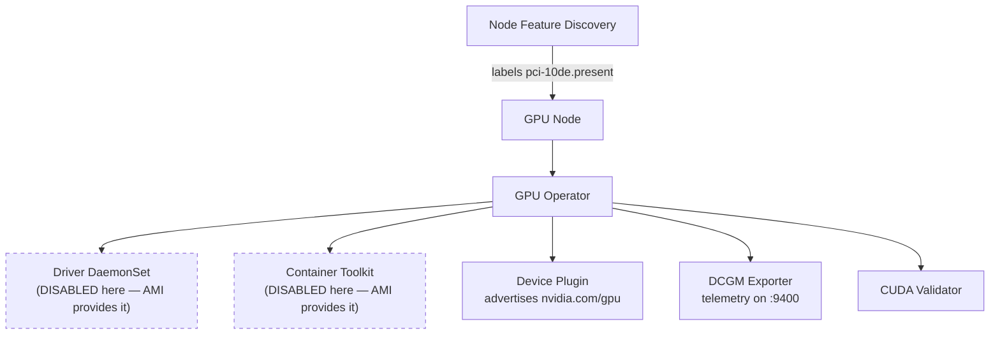

# Lab 2: The GPU Operator

## Objective

Understand what makes an NVIDIA GPU schedulable by Kubernetes, verify each
operand the GPU Operator manages, and understand why this cluster runs it with
the driver and toolkit *disabled*.

---

## The problem the operator solves

A GPU instance joining the cluster gives you nothing by default. Four separate
things must be true before a pod can request `nvidia.com/gpu`:

1. The NVIDIA kernel module is loaded on the host.
2. containerd is configured with the NVIDIA runtime, so containers get device
   nodes and driver libraries injected.
3. A device plugin is running and has registered with the kubelet over gRPC.
4. The node is labelled so the operator's DaemonSets know it has a GPU at all.

The GPU Operator manages all four as DaemonSets, driven by a `ClusterPolicy`
custom resource.



---

## Driver delivery: the decision that matters

There are two ways to get a driver onto the node, and picking the wrong one for
your AMI is the most common way this stack breaks.

| Mode | How | When to use |
|---|---|---|
| **Operator-managed** | The driver DaemonSet compiles/loads `nvidia.ko` against the running kernel at node start | Plain AL2023 or Ubuntu AMIs with no driver |
| **Pre-installed** | The AMI already ships the driver and toolkit; the operator skips both | EKS NVIDIA-optimized AMIs |

**This repository uses pre-installed mode.** The GPU `EC2NodeClass` selects
`amazon-eks-node-al2023-x86_64-nvidia-*`, which contains the driver, the
container toolkit, and a containerd already configured with the nvidia runtime.
So [`02-platform/main.tf`](../../02-platform/main.tf) sets:

```hcl
driver  = { enabled = var.gpu_driver_managed_by_operator }  # default false
toolkit = { enabled = var.gpu_driver_managed_by_operator }  # default false
```

**If you enable them anyway**, two components own one kernel module and one
containerd config. The symptom is confusing: `nvidia-smi` works fine over SSH on
the host, while `nvidia-driver-daemonset` sits in `Init:CrashLoopBackOff`
complaining the module is already loaded, and the toolkit container rewrites a
containerd config that was already correct.

Set `gpu_driver_managed_by_operator = true` only if you switch the NodeClass to a
plain AL2023 AMI.

---

## Installation

The operator is installed by Terraform, not by hand — see the `gpu_operator`
`helm_release` in [`02-platform/main.tf`](../../02-platform/main.tf). It is
applied as part of `make apply`.

To disable it entirely (useful when exercising the CPU-only path with no GPU
spend):

```bash
terraform -chdir=01-infrastructure apply -var 'install_gpu_operator=false'
```

For reference, the equivalent manual install would be:

```bash
# NOTE: the repo is /nvidia. The similarly named /nvidia-dev is NVIDIA's
# pre-release channel and will give you unreleased chart versions.
helm repo add nvidia https://helm.ngc.nvidia.com/nvidia && helm repo update

helm install gpu-operator nvidia/gpu-operator \
  -n gpu-operator --create-namespace \
  --version v26.3.3 \
  --set driver.enabled=false \
  --set toolkit.enabled=false
```

Do not run this against a cluster where Terraform manages the release — Helm will
report an existing release and the two will fight over ownership.

---

## Verification

**1. All operands reach Running**

```bash
kubectl get pods -n gpu-operator
```

The `nvidia-driver-daemonset` and `nvidia-container-toolkit-daemonset` pods are
**expected to be absent** in this configuration. You should see the operator,
NFD, the device plugin, DCGM exporter, GFD, and a completed validator.

**2. ClusterPolicy reconciles to Ready**

```bash
kubectl get clusterpolicy default -o jsonpath='{.status.state}'
```

**3. The node advertises GPU capacity**

```bash
kubectl get nodes -l accelerator=nvidia-gpu \
  -o custom-columns=NODE:.metadata.name,GPU:.status.allocatable.'nvidia\.com/gpu'
```

This is the real success condition. Everything else can look healthy while this
reads `0` or is absent, which means the device plugin never registered.

**4. Query the hardware from a container**

```bash
# Works regardless of who installed the driver:
kubectl exec -n gpu-operator ds/nvidia-device-plugin-daemonset -- nvidia-smi
```

Note this uses the **device plugin** DaemonSet. Guides commonly say
`ds/nvidia-driver-daemonset`, which does not exist here because the driver is
supplied by the AMI.

**5. Confirm NFD labelled the node**

```bash
kubectl get nodes -l feature.node.kubernetes.io/pci-10de.present=true
```

`10de` is NVIDIA's PCI vendor ID. If this returns nothing, no operand will ever
schedule, and the cause is NFD rather than anything GPU-specific.

---

## Production considerations

- **Pin the chart version.** An unpinned chart means a `helm upgrade` can roll a
  new driver across every GPU node at once. Version is a variable here
  (`gpu_operator_version`) precisely so upgrades are deliberate.
- **Prefer pre-baked drivers.** Beyond saving node bootstrap time, it removes
  kernel-header availability from the boot path — a dependency that breaks when
  the host kernel updates ahead of the driver image.
- **Toolkit installation restarts containerd.** When the operator does manage the
  toolkit, it patches containerd's config and restarts it, briefly interrupting
  CRI communication on that node. Harmless on a fresh node, disruptive on a busy
  one, and another reason pre-installed mode is preferable.

---

## Related documentation

- **Concepts:** [GPU Operator internals](../interview-notes/gpu-operator.md) · [Device Plugin API](../interview-notes/device-plugin.md)
- **Labs:** [01 Provisioning](01-gpu-node-provisioning.md) · [03 Device Plugin](03-device-plugin.md) · [04 Time Slicing](04-time-slicing.md) · [05 DCGM](05-dcgm-observability.md) · [06 Troubleshooting](06-production-troubleshooting.md)
- **Reference:** [Architecture](../architecture.md) · [Troubleshooting runbook](../troubleshooting.md) · [Performance](../performance.md)
