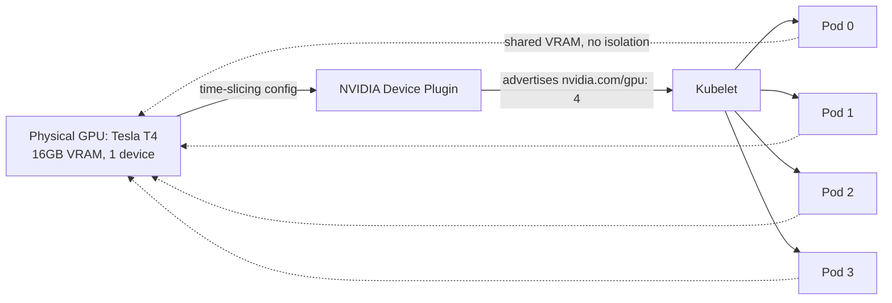

# Lab 4: GPU Time Slicing

## Objective

Present one physical GPU to the Kubernetes scheduler as several schedulable
units, verify that multiple pods land on the same card, and understand precisely
what that sharing does and does not isolate.

---

## How it works

The device plugin decides what `nvidia.com/gpu` capacity to report to the
kubelet. Time slicing tells it to advertise N units per physical device. Nothing
about the hardware changes: the driver round-robins CUDA contexts across the
replicas.



The dotted lines are the point of the lab: four schedulable units, one
unpartitioned pool of memory behind them.

---

## How this repository configures it

Time slicing is set **declaratively in Terraform**, through the GPU Operator's
Helm values in [`02-platform/main.tf`](../../02-platform/main.tf):

```hcl
devicePlugin = {
  config = {
    create  = true
    name    = "device-plugin-config"
    default = "time-sliced"
    data = {
      "time-sliced" = yamlencode({
        version = "v1"
        sharing = {
          timeSlicing = {
            resources = [{
              name     = "nvidia.com/gpu"
              replicas = var.gpu_time_slicing_replicas   # default 4
            }]
          }
        }
      })
    }
  }
}
```

Change the slice count with a variable, not by editing YAML:

```bash
terraform -chdir=01-infrastructure apply -var 'gpu_time_slicing_replicas=8'
```

Set it to `1` to disable time slicing entirely.

**Why the chart owns the ConfigMap rather than a standalone manifest:** the
device plugin reads this ConfigMap at container start. If you apply the ConfigMap
separately, it has to exist *before* the plugin DaemonSet rolls out — otherwise
the plugin starts with no sharing config, advertises `1`, and you are left
debugging why your pods are Pending. Letting the chart create both removes the
ordering race and keeps a single source of truth.

---

## Verification

**1. Confirm the ConfigMap the operator generated**

```bash
kubectl get configmap device-plugin-config -n gpu-operator -o yaml
```
Expect a `time-sliced` key containing `replicas: 4`.

**2. Confirm the node advertises the sliced capacity**

```bash
kubectl get nodes -l accelerator=nvidia-gpu \
  -o custom-columns=NODE:.metadata.name,CAPACITY:.status.capacity.'nvidia\.com/gpu',ALLOCATABLE:.status.allocatable.'nvidia\.com/gpu'
```
Expect `4`. If it reads `1`, the plugin did not pick up the config — check
`kubectl logs -n gpu-operator ds/nvidia-device-plugin-daemonset`.

**3. Deploy 4 pods that each request 1 GPU**

```bash
kubectl apply -f 03-workloads/gpu-test-pod-workloads.yaml
kubectl wait --for=condition=Ready pod -l app=gpu-load-test --timeout=10m
```

**4. The assertion that matters — all 4 pods on ONE node**

```bash
kubectl get pods -l app=gpu-load-test -o wide
```
Every row must show the **same** value in the `NODE` column. Without time
slicing, one pod would be Running and three Pending.

**5. Confirm each container sees the same physical device**

```bash
kubectl logs -l app=gpu-load-test --tail=5 --prefix
```
Each pod's `nvidia-smi -L` output reports the same GPU UUID — proof they are
sharing one card rather than holding four.

---

## Demonstrating the memory trap

The failure mode is worth seeing once, because it is the reason time slicing is
unsuitable for multi-tenancy.

A T4 has 16GB. With 4 replicas there is no per-pod limit and no enforcement — if
each pod allocates 6GB, the third allocation fails. The pod that hits the ceiling
is not necessarily the greedy one; whichever pod happens to allocate next gets
the CUDA OOM. A well-behaved tenant is killed by a noisy neighbour, and nothing
in the Kubernetes resource model prevents it.

Contrast with MIG, where each instance has hardware-enforced memory limits and an
over-allocating tenant only harms itself.

---

## Cleanup

```bash
kubectl delete -f 03-workloads/gpu-test-pod-workloads.yaml
```

To disable time slicing:

```bash
terraform -chdir=01-infrastructure apply -var 'gpu_time_slicing_replicas=1'
```

The device plugin DaemonSet restarts and the node returns to advertising `1`.

---

## Trade-offs

| | Time slicing | MPS | MIG |
|---|---|---|---|
| Compute sharing | Round-robin context switch | Concurrent kernels | Hardware-partitioned SMs |
| Memory isolation | **None** | None | **Hardware-enforced** |
| Fault isolation | None | Limited | Yes |
| Hardware support | Any NVIDIA GPU | Any NVIDIA GPU | A100 / H100 and later |
| Suitable for | Dev, notebooks, batch | Trusted cooperative work | Multi-tenant, latency SLOs |

> [!NOTE]
> Time slicing is a **cost and density** tool, not an isolation tool. Reach for it
> when several small workloads would each otherwise hold an idle card, and reach
> for MIG when correctness under contention matters.

---

## Related documentation

- **Concepts:** [Time slicing vs MIG vs MPS](../interview-notes/time-slicing.md) · [Device Plugin API](../interview-notes/device-plugin.md)
- **Labs:** [01 Provisioning](01-gpu-node-provisioning.md) · [02 GPU Operator](02-gpu-operator.md) · [03 Device Plugin](03-device-plugin.md) · [05 DCGM](05-dcgm-observability.md) · [06 Troubleshooting](06-production-troubleshooting.md)
- **Reference:** [Architecture](../architecture.md) · [Performance](../performance.md) · [Troubleshooting runbook](../troubleshooting.md)
