# GPU Performance Characteristics & Scaling Latency

> [!IMPORTANT]
> **Read this first.** The numbers in sections 2 and 3 are *expected
> characteristics* — order-of-magnitude figures drawn from NVIDIA and AWS
> documentation and from the general behaviour of this stack. They are **not**
> benchmark results measured on this cluster.
>
> Section 4 is the place for measurements from your own runs, and it is
> deliberately empty until you fill it in. Anything you have actually measured
> belongs there, clearly separated from what is merely expected.

---

## 1. Which metrics matter, and why

These are the DCGM fields worth watching on a T4, and the reasoning behind each.

| Metric | What it tells you | Why it is easy to misread |
|---|---|---|
| `DCGM_FI_DEV_GPU_UTIL` | Percentage of time at least one kernel was resident on the SMs | It measures *occupancy over time*, not throughput. A GPU running one tiny kernel forever reports 100% while doing almost nothing useful. |
| `DCGM_FI_DEV_FB_USED` / `FB_FREE` | Frame buffer (VRAM) in use | VRAM cannot swap. Exceeding it is a hard CUDA OOM, not a slowdown — which is exactly why time slicing is risky for memory-hungry workloads. |
| `DCGM_FI_DEV_POWER_USAGE` | Board power draw in watts | Sustained draw at the card's TDP is the leading indicator of thermal or power throttling. |
| `DCGM_FI_DEV_SM_CLOCK` | Current SM clock | A clock well below boost while utilization is high means you are throttling, not compute-bound. |
| `DCGM_FI_DEV_XID_ERRORS` | NVIDIA XID hardware/driver faults | The single most important alerting metric. A rising XID count means real hardware or driver trouble; on Spot, replace the node. |

**Scrape interval matters here.** GPU utilization on inference workloads is
bursty — a kernel can take the card from idle to saturated and back well inside a
30-second window. At the Prometheus default you sample the gaps and conclude the
GPU is idle. This repository scrapes at 5s
(`02-platform/monitoring/prometheus-grafana.yaml`), trading cardinality and
storage for transient visibility.

---

## 2. Time slicing: expected behaviour

*Reference characteristics, not measurements.*

Time slicing gives each container a turn on the GPU via driver-level context
switching, round-robin across the configured replicas.

```mermaid
gantt
    title Time-sliced execution windows (conceptual, 3 replicas)
    dateFormat  X
    axisFormat %s
    section Pod 1
    Execute :active, 0, 10
    Wait    :crit, 10, 30
    section Pod 2
    Wait    :crit, 0, 10
    Execute :active, 10, 20
    Wait    :crit, 20, 30
    section Pod 3
    Wait    :crit, 0, 20
    Execute :active, 20, 30
```



What follows from the mechanism:

- **No VRAM isolation.** Replicas share one address space with no per-pod limit.
  The combined working set of all containers must fit in physical VRAM, or one
  pod's allocation triggers CUDA OOM in its neighbours. This is the property that
  disqualifies time slicing for untrusted multi-tenancy.
- **Context-switch overhead.** Saving and restoring register state between
  contexts is not free, so aggregate throughput under N contending compute-heavy
  pods is lower than a single pod's. The size of the penalty depends heavily on
  kernel duration and working-set size — short kernels switch cheaply, large
  resident working sets do not. Measure it for your workload rather than assuming
  a figure.
- **Latency becomes unpredictable.** A pod waits for its slice. That is fine for
  batch and development, and unacceptable for anything with a tail-latency SLO.
- **No fault isolation.** A pod that wedges the GPU affects every other pod on
  the card.

Time slicing is a **density and cost** mechanism for low-priority, latency-
tolerant work. For guaranteed isolation use MIG (A100/H100 and later), which
partitions SMs and memory in hardware. See
[interview-notes/time-slicing.md](interview-notes/time-slicing.md).

---

## 3. Provisioning path: what happens and where the time goes

*Stages are accurate; durations are illustrative.*

From an unschedulable GPU pod to a running container:

```text
Pod submitted, no GPU capacity -> Pending
  |
  +-> Karpenter observes the pending pod and simulates scheduling
  +-> Karpenter calls EC2 CreateFleet for a matching Spot instance
  |     (Spot capacity errors surface here; this is where a zero G-instance
  |      quota shows up as endless "insufficient capacity")
  +-> Instance boots from the EKS NVIDIA-optimized AL2023 AMI, kubelet registers
  +-> Node Feature Discovery labels the node (feature.node.kubernetes.io/pci-10de.present)
  +-> GPU Operator operands schedule onto the labelled node
  +-> Device plugin registers with the kubelet over gRPC and advertises nvidia.com/gpu
  +-> Scheduler binds the pod; image pull; container starts
```

The dominant costs are **EC2 instance boot** and **container image pull**, and on
this stack they are the two worth optimising.

**The driver compile step does not apply here.** A common description of this
pipeline includes 20–30s of dynamic kernel module compilation by the GPU
Operator's driver DaemonSet. This repository does not incur that: the GPU
EC2NodeClass selects the EKS NVIDIA-optimized AMI, which ships the driver and
container toolkit pre-installed, and the operator is configured with
`driver.enabled=false` / `toolkit.enabled=false`. That AMI choice *is* the
optimisation — the trade is a larger AMI and a dependency on AWS's release
cadence for driver versions.

Remaining levers, roughly in order of impact:

1. **Pre-pull large images.** The CUDA `devel` image is several GB. Pulling it on
   a cold node dominates everything else. Bake it into a custom AMI or warm it
   with a DaemonSet.
2. **Keep warm capacity.** A NodePool with a non-zero minimum trades idle GPU
   cost for eliminating provisioning latency entirely.
3. **Widen the instance-type list.** More types means a larger Spot pool, fewer
   capacity failures and retries.

---

## 4. Measured results

Fill this in from your own runs so it is unambiguous which numbers are yours.

To time a cold GPU provisioning cycle:

```bash
kubectl delete -f 03-workloads/gpu-test-deployment.yaml --ignore-not-found
kubectl wait --for=delete node -l accelerator=nvidia-gpu --timeout=5m

date +%s
kubectl apply -f 03-workloads/gpu-test-deployment.yaml
kubectl wait --for=condition=Ready pod -l app=gpu-test --timeout=15m
date +%s

# Per-stage detail:
kubectl get events --sort-by=.lastTimestamp -A | grep -Ei 'nodeclaim|scheduled|pulling|pulled|started'
```

| Measurement | Instance type | Value | Date | How measured |
|---|---|---|---|---|
| Pending pod to Ready node | | | | |
| Ready node to `nvidia.com/gpu` advertised | | | | |
| Image pull duration (CUDA devel) | | | | |
| End-to-end pod Pending to Running | | | | |
| Peak power draw under sustained load | | | | `DCGM_FI_DEV_POWER_USAGE` |
| GPU utilization, 1 pod vs N time-sliced | | | | `DCGM_FI_DEV_GPU_UTIL` |

---

## 5. Production considerations

> [!NOTE]
> **Sharing strategy by workload class**
>
> - **Time slicing** — dev sandboxes, notebooks, low-throughput batch inference.
>   Cheap and simple; no isolation of any kind.
> - **MPS** — cooperative concurrent kernels from trusted workloads. Better
>   throughput than time slicing, still no memory protection.
> - **MIG** — hardware-partitioned SMs and memory on A100/H100+. The only option
>   that gives real multi-tenant isolation and predictable latency.
> - **Exclusive** — one pod, one card. Correct for training and for anything
>   latency-sensitive.

---

## Related documentation

- **System:** [Architecture](architecture.md) · [Troubleshooting runbook](troubleshooting.md) · [Roadmap](roadmap.md)
- **Concepts:** [Device Plugin](interview-notes/device-plugin.md) · [GPU Operator](interview-notes/gpu-operator.md) · [Time slicing vs MIG vs MPS](interview-notes/time-slicing.md) · [Karpenter](interview-notes/karpenter.md)
- **Journal:** [Lessons learned](lessons-learned.md)
